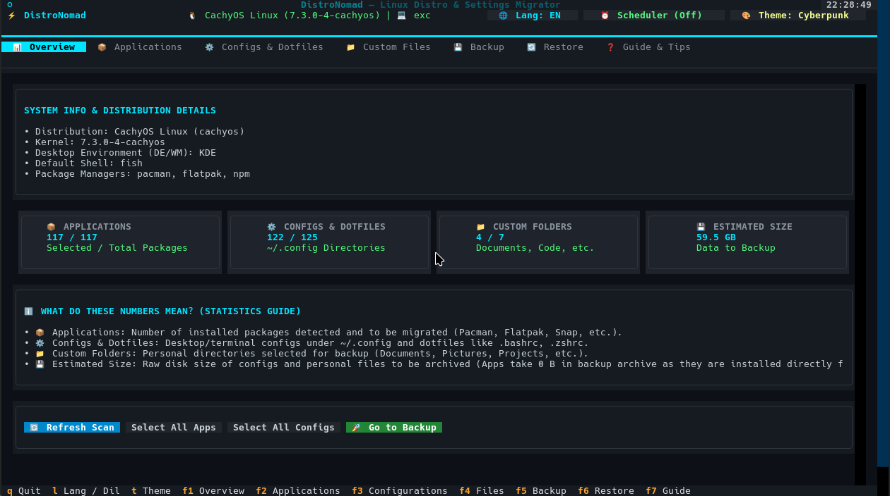

# 🏕️ DistroNomad

<div align="center">


[](https://www.python.org/downloads/)
[](https://www.kernel.org)
[](https://textual.textualize.io/)
[](LICENSE)

**Seamless Linux Distro Migration, Selective Backup & Dotfiles Manager**  
*Format atmadan veya yeni bir Linux dağıtımına geçmeden önce ayarlarınızı, uygulamalarınızı ve dosyalarınızı kayıpsız taşıyın.*

[English](#-english) | [Türkçe](#-türkçe)



</div>

---

## 🇹🇷 Türkçe

**DistroNomad**, bir Linux dağıtımından diğerine geçerken ("distro-hopping") veya sisteminizi yeniden kurarken; kurulu uygulamalarınızı, masaüstü & terminal ayarlarınızı (`dotfiles`), tarayıcı profillerinizi, Flatpak uygulama verilerinizi, sistem durumunuzu ve kişisel dosyalarınızı görsel bir arayüzle seçip yedeklemenizi ve yeni sistemde tek tıkla geri yüklemenizi sağlayan modern bir terminal (TUI) ve komut satırı (CLI) aracıdır.

> [!WARNING]
> DistroNomad aktif geliştirme aşamasındadır ve [MIT Lisansı](LICENSE) kapsamında garantisiz, "olduğu gibi" sunulur; veri kaybı veya sistem sorunlarından geliştiriciler sorumlu değildir. Eski sisteminizi silmeden önce yedeğinizi `distronomad verify` ile doğrulayın, geri yüklemeyi önce `--dry-run` ile deneyin ve önemli verilerinizin bağımsız bir kopyasını saklayın.

### ✨ Öne Çıkan Özellikler

- **🎨 Modern Terminal Arayüzü (btop++ & Cyberpunk Stili):**
  - Textual tabanlı, canlı renk paletine (Cyberpunk, Tokyo Night, Dracula, Nord, CachyOS Emerald, Monokai) sahip, fare ve klavye destekli tasarım.
  - Canlı filtreleme, sepet tablosu, anlık boyut hesaplama ve ilerleme çubuğu.
- **📁 Gelişmiş Özel Dosya & Klasör Yöneticisi (F4):**
  - Dosya ve klasör seçicide eklenen her bir ögenin dosya sayısı ve insan tarafından okunabilir boyutu anında hesaplanıp listelenir.
  - Özel dosyalar sekmesinde canlı arama ve filtreleme kutusu.
  - Vazgeçilen dosya ve klasörler tek tek seçilerek (`Seçilenleri Çıkar`, `Del`, `Backspace`, `x`) veya topluca (`Tümünü Temizle`) arayüzden ve yedek listesinden kolayca çıkarılabilir.
- **🔄 Mevcut Yedeğe Sonradan Ekleme (`distronomad append`):**
  - Daha önce oluşturulmuş bir yedeği sıfırdan yeniden oluşturmaya gerek kalmadan, sonradan eklemek istediğiniz klasör ve dosyaları (`--path`), konfigürasyonları (`--config`) veya paketleri (`--package`) mevcut arşivin içine dahil edebilirsiniz.
  - Standart arşivler (`.tar.zst`, `.tar.gz`, `.tar`) ile AES-256 ile şifrelenmiş arşivleri (`.enc`) tam olarak destekler.
  - Geri Yükle sekmesinde tek tıkla *"Bu Yedeğe Yeni Ögeler Ekle"* kısayolu ile doğrudan mevcut yedeği genişletme imkanı.
- **📦 Evrensel Paket Tespiti ve Çapraz Dağıtım Çevirisi (Cross-Distro):**
  - **Paket Yöneticileri:** `pacman` (Arch/CachyOS/Manjaro), `apt` (Debian/Ubuntu/Mint), `dnf` (Fedora), `zypper` (openSUSE).
  - **Evrensel Paketler & Eklentiler:** `flatpak`, `snap`, `pipx`, `cargo`, `npm`, **VS Code & VSCodium Eklentileri (`vscode` / `codium`)**.
  - Dağıtım değiştirdiğinizde (örneğin Arch'tan Fedora veya Ubuntu'ya) paket adlarını otomatik olarak hedef dağıtım depolarına göre çevirir!
- **⚙️ Tam Kapsamlı Masaüstü, Tarayıcı, Flatpak ve Sistem Durumu Koruması:**
  - **Konfigürasyonlar & Kabuk Geçmişi:** `~/.config` altındaki pencere yöneticileri (Hyprland, Sway, i3), terminaller (Kitty, Alacritty), editörler (Neovim, VS Code). Kabuk komut geçmişleri (`.bash_history`, `.zsh_history`, `fish_history`, `atuin`) tespit edilir; güvenlik gereği hassas işaretlenir ve varsayılan olarak seçimsiz gelir.
  - **Tarayıcı & E-Posta Profilleri:** `~/.config` dışında tutulan **Firefox, Thunderbird, Zen Browser, LibreWolf, Waterfox** profillerini önbellek çöplerini (`cache2`, `startupCache`, `GrShaderCache`) otomatik temizleyerek yedekler.
  - **Flatpak Uygulama Verileri & İzinleri:** `~/.var/app` altındaki uygulama içi verileri ve Flatseal izin özelleştirmelerini (`~/.local/share/flatpak/overrides`) korur.
  - **GNOME & KDE Plasma Masaüstü Ayarları:** `dconf dump /` anlık görüntüsü, GNOME Shell eklentileri, Nautilus betikleri, KDE Plasma (`konsole`, `plasma`, `color-schemes`, `kxmlgui5`, `aurorae`) ve özel `.desktop` kısayolları.
  - **Hassas Kimlik & Bulut Anahtarları (Varsayılan Seçimsiz):** `.ssh`, `.gnupg`, `.npmrc`, `.pypirc`, `.netrc`, `.kube`, `.aws`, `.docker`, `.password-store` (`pass`), GNOME Keyring (`keyrings`), KDE KWallet (`kwalletd`) ve DBeaver bağlantılarını tespit eder. Güvenlik gereği tüm bu hassas ögeler varsayılan olarak seçili gelmez.
  - **Linux Oyun & Taşınabilir Uygulamalar:** Lutris, Heroic, MangoHud, Proton-GE (`compatibilitytools.d`), `~/Games` ve `~/Applications` (AppImage).
  - **Sistem Durumu & `/etc` Referans Yedeği (`system_state/`):** Kullanıcı grupları (`groups`), `crontab -l`, etkin `systemd --user` servisleri ve `/etc/fstab`, `/etc/hosts`, `/etc/udev/rules.d` referans kopyaları. Wi-Fi parolaları ve özel anahtarlar içeren NetworkManager ile WireGuard profilleri güvenlik gereği yalnızca şifreli yedeklere ve yalnızca root yetkisiyle çalıştırıldığında dahil edilir; şifresiz yedeklerde otomatik atlanır.
- **🎯 Seçici Geri Yükleme (Granular Restore) & Bağımsız İki Dilli `restore.sh`:**
  - Yeni sistemde arşivdeki tüm uygulamaları, ayarları ve dosyaları listeleyip sadece istediklerinizi seçerek geri yükleyebilirsiniz. Çakışma stratejileri (`backup`, `overwrite`, `skip`) ve simülasyon modu (`--dry-run`) mevcuttur.
  - **Ev Dizini Dışı Güvenliği:** Ev dizini dışındaki özel yollar olası sistem üzerine yazma risklerine karşı varsayılan olarak atlanır; yalnızca açık kullanıcı onayı (`--allow-external-paths`) ile geri yüklenir. Hedef ev dizini gerçek ev dizini değilse mutlak sistem kök yollarına asla yazılmaz.
  - Yedeğin içine sıfır bağımlılıklı `restore.sh` betiği otomatik eklenir. Yeni sistemde Python kurulu olmasa dahi `./restore.sh` ile her şeyi geri yükleyebilirsiniz. `restore.sh` iki dillidir (ortam yerelini otomatik algılar veya `--lang tr|en` seçeneği alır).
- **🔒 Güvenlik, Fark Analizi ve Geri Alma:**
  - **AES-256 Şifreleme:** İsteğe bağlı parola koruması ve parola teyit doğrulaması (varsayılan kapalı).
  - **Diff Viewer & 1-Tıkla Rollback:** Geri yüklemeden önce mevcut sistemle yedek arasındaki dosya farklarını inceleme ve beklenmedik durumlarda `distronomad rollback` ile tek tıkla geri alma.
  - **systemd Zamanlayıcı:** İsteğe bağlı otomatik periyodik yedekleme (`distronomad schedule --enable`).
- **🔍 Akış Tabanlı Yedek Bütünlük Doğrulama (`distronomad verify`):**
  - Arşivi diske açmadan, sıfır ek disk alanıyla doğrudan akış üzerinden SHA-256 sağlama toplamı kontrolü (`.tar.zst`, `.tar.gz`, `.tar`, `dir` ve şifreli `.enc`).
  - Geri Yükle sekmesinde `Yedeği Doğrula` düğmesi, Yedekle sekmesinde `Yedek bitince bütünlüğü doğrula` kutusu ve headless CLI `distronomad verify --src YOL` komutu.
- **💾 USB Bellek & FAT32 Dosya Sistemi Koruması:**
  - Fabrika çıkışı FAT32 formatlı USB belleklerde tek dosya sınırı 4 GB'tır. 4 GB'ı aşabilecek büyük arşivler için USB belleğinizi **exFAT** veya **ext4** olarak biçimlendirmeniz önerilir. DistroNomad, FAT32 hedeflerde olası boyutu önceden tespit ederek uyarır; dosya izinleri ve sembolik bağlar FAT32 üzerinde desteklenmediği için `dir` formatı doğrudan engellenmez, ancak kullanıcı uyarılıp arşiv formatı önerilir ve devam etmek için onay veya `--force` istenir (`--force` ile sembolik bağlar güvenle atlanır).
- **🌐 İki Dilli Kullanım & Dil Kuralı:**
  - Arayüzde `L` tuşu ile, komut satırında `--lang tr` / `--lang en` parametresiyle (alt komuttan önce veya sonra) tam Türkçe ve İngilizce desteği.
  - **Varsayılan Dil Kuralı:** Kayıtlı bir ayar varsa o kullanılır; ayar yoksa sistem yerel ortam değişkenleri (`LANG`, `LC_ALL`, `LC_MESSAGES`) "tr" ile başlıyorsa Türkçe, aksi takdirde (C, POSIX, Almanca vb. dahil) varsayılan olarak İngilizce açılır.

---

## 🇬🇧 English

**DistroNomad** is a modern terminal-based migration, selective backup, and dotfiles management utility for Linux enthusiasts, developers, gamers, and distro-hoppers. It inspects your installed applications, captures your dotfiles, browser profiles, Flatpak app data, desktop environment state (`dconf` & KDE Plasma), and personal directories, and effortlessly restores them on your fresh Linux installation via interactive TUI or headless CLI.

> [!WARNING]
> DistroNomad is in active development and is provided "as is", without warranty, under the [MIT License](LICENSE); the authors are not responsible for data loss or system issues. Before wiping your old system, verify your backup with `distronomad verify`, try the restore with `--dry-run` first, and keep an independent copy of important data.

### ✨ Key Capabilities

- **Modern Cyberpunk / btop++ TUI:** Built with Textual, featuring 6 rich themes (Cyberpunk, Tokyo Night, Dracula, Nord, CachyOS Emerald, Monokai), full keyboard/mouse control, live filtering, and real-time responsiveness.
- **Custom Files & Directory Manager (F4):** Interactive inspection of added custom paths with file counts and human-readable sizes, real-time search filtering, and single or bulk removal (`Del`, `Backspace`, `x`).
- **In-Place Backup Append (`distronomad append`):** Append newly discovered applications (`--package`), configs (`--config`), and files/folders (`--path`) directly into an existing archive (`.tar.zst`, `.tar.gz`, `.tar`, or encrypted `.enc`) without recreating the backup from scratch.
- **Cross-Distro Package Mapping + VS Code Extensions:** Automatically translates package names across distribution families (Arch ↔ Debian/Ubuntu ↔ Fedora ↔ openSUSE) and restores Flatpak, Snap, Pipx, Cargo, NPM, and VS Code / VSCodium extensions.
- **Comprehensive Desktop, Browser & Flatpak Preservation:**
  - Captures Firefox, Thunderbird, Zen, and LibreWolf profiles outside `~/.config` (while automatically stripping browser cache directories).
  - Preserves Flatpak app data (`~/.var/app`) and Flatseal permission overrides.
  - Snapshots GNOME `dconf` settings, GNOME extensions, KDE Plasma schemes/configs, gaming directories (Proton-GE, Lutris), and `.desktop` shortcuts.
  - **Sensitive Credentials Safety (Unselected by Default):** Shell command histories (`.bash_history`, `.zsh_history`, `fish_history`, `atuin`) and credential files (`.ssh`, `.gnupg`, `.npmrc`, `.pypirc`, `.netrc`, `.docker`, `.aws`, `.kube`, `.password-store`, KWallet, GNOME Keyring) are automatically flagged as sensitive and left unchecked by default.
  - Safely archives `/etc/fstab`, `/etc/hosts`, `udev` rules, `crontab`, and `systemd --user` units as reference copies (`system_state/`). NetworkManager and WireGuard profiles (containing Wi-Fi passwords and private keys) are only included in encrypted backups and only when run as root; they are safely skipped in unencrypted backups.
- **Granular Restore & Bilingual Standalone `restore.sh`:**
  - Granular restoration of packages, configs, or files with conflict resolution (`backup`, `overwrite`, `skip`) and `--dry-run` simulation.
  - **External Path Protection:** Paths outside the home directory are safely skipped by default, and only restored when explicitly confirmed (`--allow-external-paths`). Non-matching target homes are never written to host root.
  - Generated inside every archive: a zero-dependency standalone `restore.sh` script (Bash 4+) that runs on minimal fresh installs without Python. Fully bilingual with automatic locale detection and `--lang tr|en`.
- **Security, Integrity & Rollback:**
  - Optional AES-256 password encryption with password confirmation.
  - Streaming SHA-256 integrity verification (`distronomad verify`) without unpacking to disk.
  - Proactive FAT32 4 GB limit safeguard (recommending exFAT or ext4 for USB drives). Directory format backups on FAT32 are not blocked outright, but a warning is issued recommending archive format, and explicit confirmation or `--force` is requested (with `--force`, symlinks are safely skipped).
  - Unified diff viewer and one-click transaction rollback engine (`distronomad rollback`).
- **Dual Language Support & Default Rule:**
  - Seamless switching between English and Turkish in TUI (`L` key), CLI (`--lang tr` / `--lang en`), and `restore.sh`.
  - **Default Language Rule:** Uses saved setting if configured; otherwise defaults to Turkish if `LANG`, `LC_ALL`, or `LC_MESSAGES` starts with `tr`, and defaults to English for all other locales (including C, POSIX, German, etc.).

---

## 🚀 Hızlı Başlangıç / Quickstart

### 📋 Önkoşullar / Prerequisites

- **Python:** 3.9 veya üzeri (Python 3.9+)
- **Debian / Ubuntu:** Sanal ortam modülü kurulu olmalıdır:
  ```bash
  sudo apt install python3-venv python3-pip
  ```
- **Şifreleme (İsteğe bağlı):** Parola korumalı yedekler için sistemde `openssl` bulunmalıdır.
- **restore.sh:** Bağımsız kurtarma betiği için `bash` (4.0+).

---

### 1. Depoyu İndirin veya Klonlayın / Download or Clone

Depoyu klonlayın (veya GitHub sayfasındaki yeşil **Code** düğmesinden ZIP/tarball arşivini indirip açın):

```bash
git clone https://github.com/muratboy/distronomad.git
cd distronomad
```

---

### 2. Kurulum Seçenekleri (PEP 668 Uyumlu) / Installation Options

Modern Linux dağıtımlarında (Debian 12+, Ubuntu 23.04+, Fedora, Arch vb.) sistem Python ortamını korumak için aşağıdaki yöntemlerden birini tercih edin:

#### Seçenek A: `pipx` ile Kurulum (Önerilen CLI/TUI aracı kullanımı)
Dağıtımınızın sistem paket yöneticisini kirletmeden, yalıtılmış bir ortamda kurar ve `distronomad` komutunu doğrudan sisteminize tanıtır:

*Sisteminizde `pipx` kurulu değilse:*
- **Debian / Ubuntu:** `sudo apt install pipx`
- **Arch Linux:** `sudo pacman -S python-pipx`
- **Fedora:** `sudo dnf install pipx`
*(Gerekirse ortam yolu güncellemesi için: `pipx ensurepath`)*

```bash
pipx install .
distronomad
```

#### Seçenek B: Python Sanal Ortamı (`venv`) ile Kurulum
```bash
python3 -m venv .venv
source .venv/bin/activate
pip install .
distronomad
```
*(Geliştirme ve test katkısı için: `pip install -e ".[test]"` — bkz. [CONTRIBUTING.md](CONTRIBUTING.md))*

#### Seçenek C: `run.sh` ile Kurulumsuz Çalıştırma
Depo kök dizinindeki hızlı başlatıcı, sanal ortamı otomatik hazırlar ve uygulamayı doğrudan çalıştırır:
```bash
./run.sh
```

#### Seçenek D: Bağımsız Taşınabilir USB Paketi (Portable Bundle)
Host sistemde Python veya paket yöneticisi bulunmasa dahi USB bellekten doğrudan çalıştırmak için `scripts/build_portable.sh` ile bağımsız bir paket derlenebilir veya yayınlanan hazır taşınabilir paket doğrudan USB'den çalıştırılabilir:
```bash
./run.sh  # Taşınabilir paket dizini içinde
```

---

### 3. Komut Satırı (CLI) Kullanımı / CLI Usage

DistroNomad hem grafiksel TUI hem de betiklenebilir headless CLI komutlarını destekler:

```bash
# Görsel Terminal Arayüzünü (TUI) Başlat
distronomad
distronomad tui --lang tr

# Sistem Bileşenlerini Tara (Headless Scan)
distronomad scan
distronomad scan --lang en

# Tam Sistem Yedeği Al (Full Backup)
distronomad backup --dest /media/usb/backup.tar.zst
distronomad backup --dest /media/usb/backup.tar.zst --configs-only
distronomad backup --dest /media/usb/backup.tar.zst --no-sensitive
distronomad backup --dest /media/usb/backup.tar.zst.enc --password

# Artımlı Yedek Al (Incremental Backup)
distronomad backup --dest /media/usb/inc1.tar.zst --incremental --base /media/usb/backup.tar.zst

# Yedek Bütünlüğünü Doğrula (Verify)
distronomad verify --src /media/usb/backup.tar.zst
distronomad verify --src /media/usb/backup.tar.zst.enc --password

# Mevcut Yedeğe Yeni Dosya, Ayar veya Paket Ekle (Append)
distronomad append --backup /media/usb/backup.tar.zst --path ~/Belgeler/YeniKlasor
distronomad append --backup /media/usb/backup.tar.zst --config .config/nvim
distronomad append --backup /media/usb/backup.tar.zst --package pacman:ripgrep
distronomad append --backup /media/usb/backup.tar.zst --path ~/Belgeler --config .config/nvim --package pacman:ripgrep

# Fark Analizi (Diff)
distronomad diff --src /media/usb/backup.tar.zst
distronomad diff --src /media/usb/backup.tar.zst --show-content

# Geri Yükleme (Restore)
distronomad restore --src /media/usb/backup.tar.zst --dry-run
distronomad restore --src /media/usb/backup.tar.zst --conflict backup
distronomad restore --src /media/usb/backup.tar.zst --configs-only
distronomad restore --src /media/usb/backup.tar.zst --allow-external-paths

# Geri Alma (Rollback)
distronomad rollback

# Otomatik Yedekleme Zamanlayıcı (Schedule)
distronomad schedule --enable --interval daily
distronomad schedule --disable
```

> [!TIP]
> **🔐 CLI Parola Güvenliği / Password Security:**
> - **Etkileşimli Sorma / Interactive Prompt:** Parolayı komut satırında açık metin olarak iletmek kabuk geçmişine ve `ps` işlem listesine sızma riski oluşturur. Bu nedenle `--password` (veya `-p`) seçeneğini değersiz kullanın; DistroNomad parolanızı terminalde etkileşimli ve maskelenmiş olarak (`getpass`) sorar (`backup` ve `append` onay için iki kez sorar). Şifreli arşivler terminalde parolasız çağrıldığında da otomatik parola sorulur.
> - **Ortam Değişkeni / Environment Variable:** Betik ve otomasyonlar için parola `DISTRONOMAD_PASSWORD` ortam değişkeniyle güvenle aktarılabilir (`export DISTRONOMAD_PASSWORD="parolaniz"`).

---

### 4. Çıkış Kodları / Exit Codes

CLI komutları ve betik entegrasyonları için çıkış kodları:

| Kod / Code | Anlamı (TR) | Meaning (EN) |
|:---:|---|---|
| `0` | İşlem başarıyla tamamlandı | Operation completed successfully |
| `1` | Hata veya başarısız işlem | Error or failed operation |
| `2` | Geçersiz komut satırı argümanları | Invalid command line arguments |
| `3` | Yedekleme tamamlandı ancak bazı dosyalar okunamadı / atlandı | Backup completed but some files could not be read / were skipped |

---

## 🔍 Yedek Bütünlük Doğrulama / Backup Verification

Eski sisteminizi silmeden veya format atmadan önce USB belleğinizdeki yedeğin sağlam ve eksiksiz olduğunu kanıtlamak kritik önem taşır. `distronomad verify` arşivi diske açmadan akış halinde SHA-256 sağlama toplamlarını denetler.

> [!IMPORTANT]
> **Fiziksel USB Doğrulama İpucu:** Fiziksel USB sürücülerde en güvenilir doğrulama için, yedekleme tamamlandıktan sonra USB belleği güvenle çıkarıp (`umount` / `sync`) yeniden taktıktan sonra doğrulama yapın. Yazmanın hemen ardından yapılan doğrulama verileri fiziksel flash hücrelerinden değil işletim sistemi çekirdeğinin disk önbelleğinden (RAM / page cache) okuyabilir. USB'yi çıkarıp takmak önbelleği sıfırlayarak medyanın gerçekten hatasız okunduğunu doğrulamanızı sağlar.

> [!NOTE]
> **Physical USB Verification Tip:** For physical USB flash drives, safely unmount and disconnect the drive, then reconnect it before running verification. Immediate verification after writing may read from the kernel's memory page cache rather than physical flash cells; re-plugging the USB forces reads directly from the media to verify true physical integrity.

---

## 🗺️ Özel Paket ve Flatpak Eşlemeleri / Custom Mappings

DistroNomad, varsayılan paket eşlemelerini genişletmek veya geçersiz kılmak için kullanıcı tanımlı kuralları destekler. `$XDG_CONFIG_HOME/distronomad/mappings.json` (veya `~/.config/distronomad/mappings.json`) dosyasını oluşturarak kendi eşlemelerinizi tanımlayabilirsiniz:

```json
{
  "packages": {
    "bat": {
      "debian": "batcat",
      "fedora": "bat"
    },
    "my-cli": {
      "arch": "my-cli-git",
      "debian": "my-cli-bin"
    }
  },
  "flatpak": {
    "my-app": "com.example.MyApp"
  }
}
```

- **Öncelik:** Aynı paket için kullanıcı tanımlı kurallar varsayılan kuralların üzerine yazılır (override eder).
- **Hata Toleransı:** Dosya bozuksa veya şeması geçersizse uygulama çökmez; uyarı günlüğü düşülüp dosya yok sayılır ve varsayılan eşlemelerle devam edilir.

---

## ⌨️ Klavye Kısayolları / Keybindings

| Kısayol / Key | İşlev (TR) | Function (EN) |
|---|---|---|
| `F1` - `F7` | Sekmeler Arası Geçiş | Switch Tabs (Overview, Apps, Configs, Files, Backup, Restore, Guide) |
| `L` | Dil Değiştir (TR ↔ EN) | Toggle Interface Language |
| `T` | Tema Değiştir | Cycle Themes (Cyberpunk, Tokyo Night, Dracula, Nord, etc.) |
| `Space` | Öğe Seç / Kaldır | Toggle checkbox selection |
| `Enter` / `Del` | Sepetten Öğe Çıkar | Remove focused item from Backup Cart (F5) |
| `Tab` / `Shift+Tab` | Butonlar / Widgetler Arası Geçiş | Focus next / previous widget |
| `Q` / `Ctrl+C` | Çıkış | Quit application |

---

## 🧪 Testler ve İzolasyon / Tests & Isolation

DistroNomad, testlerin ana işletim sistemine (`HOME`, `XDG_*`, masaüstü ayarları, paket yöneticileri) dokunmasını engelleyen otomatik yalıtım altyapısına (`tests/conftest.py`) sahiptir.

```bash
# Sanal ortam içinde testleri çalıştırma:
pytest -q
```

Geliştirme ortamı kurulumu, katkı kılavuzu ve Bubblewrap (`bwrap`) sandbox test yönergeleri için [CONTRIBUTING.md](CONTRIBUTING.md) dosyasına bakabilirsiniz.

---

## 📄 Lisans / License

Bu proje [MIT Lisansı](LICENSE) altında açık kaynak olarak dağıtılmaktadır.
